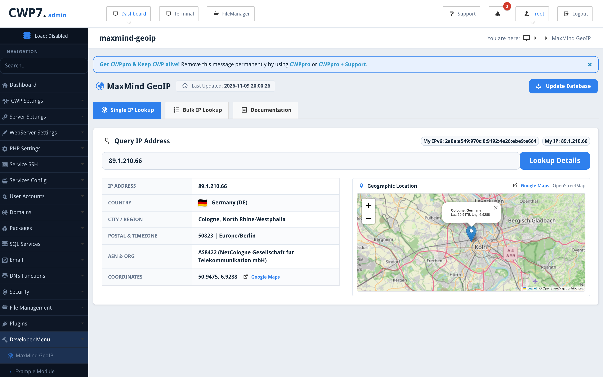
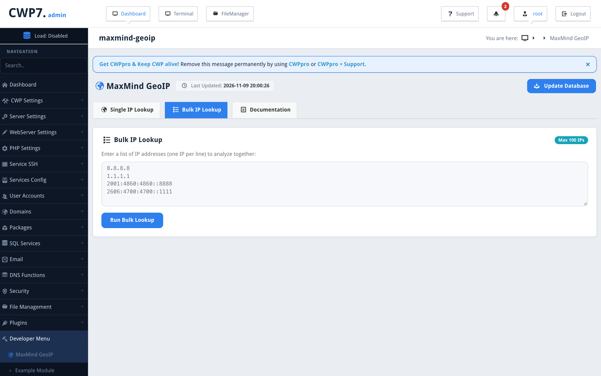

# MaxMind GeoIP Module for Control Web Panel (CWP)

A high-performance, native MaxMind GeoLite2 (`.mmdb`) IP lookup and geolocation module designed for [Control Web Panel (CWP)](https://control-webpanel.com/).

---

## 📸 Screenshots

### Single IP Geolocation with Interactive Map


### Bulk IP Lookup (Up to 100 IPs)


---

## ✨ Key Features

- **🚀 Microsecond MMDB Engine**: Queries local `.mmdb` binary databases via native `mmdblookup` in microseconds with zero external API rate limits or recurring costs.
- **🔍 Deep IP Geolocation**: Inspect Country & Flag, City & Subdivision / Region, Postal Code, Timezone, ASN & ISP Organization, and exact Coordinates.
- **🗺️ Interactive Map & Direct Directions**: Dynamic embedded map preview via OpenStreetMap and direct 1-click navigation link to Google Maps.
- **📋 Bulk IP Lookup**: Analyze up to 100 IPv4 / IPv6 addresses simultaneously in a responsive, left-aligned data table with individual inspection.
- **⚡ Server-Wide PHP Integration**: Seamless single-function integration (`maxmind_geoip($ip)`) available to every website and script hosted on the server.
- **🔄 1-Click Database Updates**: Update City, Country, and ASN databases directly from the panel header with `Last Updated` status indicators.
- **🎨 Standardized CWP Design**: Action buttons in CWP blue (`#2f80ed`) and uniform left-aligned tables.

---

## 🚀 Installation

Run on your CWP server as `root`:

```bash
curl -fsSL https://raw.githubusercontent.com/QadirAdamson/CWP-Module-MaxMind-GeoIP/main/install.sh | bash
```

Access in CWP Admin Panel: 👉 **Developer → MaxMind GeoIP**

---

## 💻 Server-Wide PHP Usage

Any PHP application or site hosted on the server can query geolocation locally:

```php
<?php
require_once '/usr/share/MaxMindGeoIP/maxmind_geoip.php';

$geoip = maxmind_geoip('8.8.8.8');

echo "Country: " . $geoip['country_name'] . " (" . $geoip['country_code'] . ")\n";
echo "City:    " . $geoip['city'] . "\n";
echo "ASN:     " . $geoip['asn'] . " " . $geoip['org'] . "\n";
```

---

## 🗑️ Uninstallation

Run on your CWP server as `root`:

```bash
curl -fsSL https://raw.githubusercontent.com/QadirAdamson/CWP-Module-MaxMind-GeoIP/main/uninstall.sh | bash
```

---

## 📄 License

This project is open-source and licensed under the [MIT License](LICENSE).
