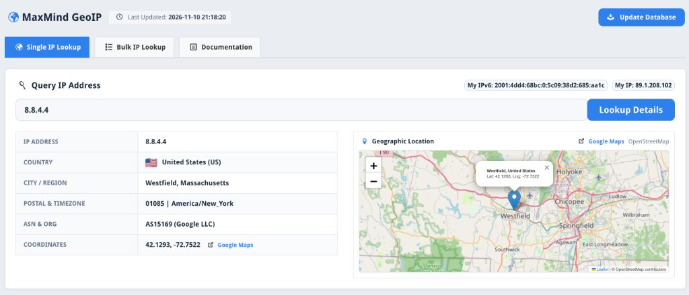

# MaxMind GeoIP Module for Control Web Panel (CWP)

MaxMind GeoLite2 IP lookup and geolocation module for [Control Web Panel (CWP)](https://control-webpanel.com/).

---



---

## Features

- Local IP geolocation lookups
- Detailed location and network data
- Single and bulk IP address analysis
- Server-wide PHP helper function
- Database update management

---

## Installation

Run on your CWP server as `root`:

```bash
curl -fsSL https://raw.githubusercontent.com/QadirAdamson/CWP-Module-MaxMind-GeoIP/main/install.sh | bash
```

Access in CWP Admin Panel: **Developer → MaxMind GeoIP**

---

## Usage

Any PHP application on the server can query geolocation locally:

```php
<?php
require_once '/usr/share/MaxMindGeoIP/maxmind_geoip.php';
$geoip = maxmind_geoip('8.8.8.8');
// print_r($geoip);
```

---

## Uninstallation

Run on your CWP server as `root`:

```bash
curl -fsSL https://raw.githubusercontent.com/QadirAdamson/CWP-Module-MaxMind-GeoIP/main/uninstall.sh | bash
```

---

## License

MIT License
